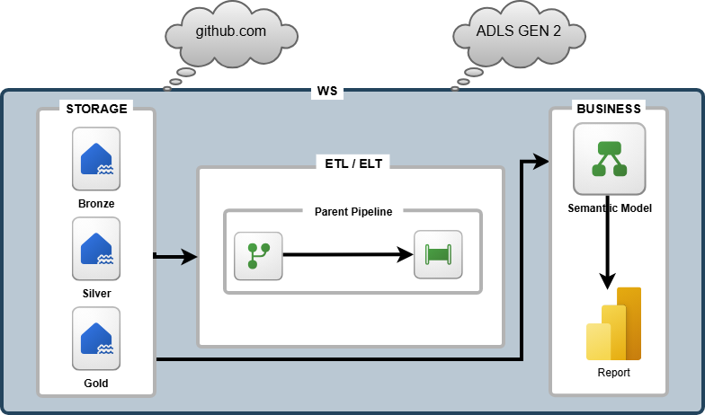

# Sales Analysis — Microsoft Fabric Data Engineering Project

## Project Overview

This project aims to build an end-to-end data engineering and analytics solution using Microsoft Fabric. The goal is to design a scalable data platform that ingests, transforms, and organizes sales data into actionable insights, following the Medallion Architecture (Bronze, Silver, and Gold).

## Architecture & Data Flow

The solution is organized into three main layers:

- **Bronze Layer:** Stores raw ingested data, preserving the original source information.
- **Silver Layer:** Cleans, validates, and transforms data to improve its quality and consistency.
- **Gold Layer:** Provides curated, business-ready datasets optimized for analytics and reporting.

## Source Data

The project uses CSV files as the source data for sales analysis. Data will be retrieved from two sources:

- **GitHub:** CSV files stored in the project repository.
- **Azure Data Lake Storage Gen2 (ADLS Gen2):** CSV files stored in the data lake.

The ingestion process loads the source files into the Bronze layer of the Lakehouse, where the raw data is preserved before further processing.

## Data Orchestration & Transformation

Microsoft Fabric Data Factory pipelines orchestrate the ETL/ELT workflows. A parent pipeline coordinates the execution of reusable processing activities, enabling a modular and maintainable data integration process.

Python, PySpark, and SQL are used for data transformation and processing across the different layers.

## Analytics & Reporting

The Gold layer serves as the foundation for the semantic model, which exposes business-oriented data for analysis in Power BI. The final reports provide insights into sales performance and support data-driven decision-making.

## Version Control

GitHub is used for source code management and version control throughout the project. It provides a centralized repository for maintaining project files, tracking changes, managing versions, and documenting the development process.

This approach supports a structured and maintainable workflow for the evolution of the data engineering solution.

## Key Technologies

- Microsoft Fabric
- OneLake / Lakehouse
- Medallion Architecture (Bronze, Silver, Gold)
- Data Factory Pipelines
- Python & PySpark
- SQL
- Power BI Semantic Models and Reports
- GitHub and Git-based version control
- Azure Data Lake Storage Gen2 (ADLS Gen2)
